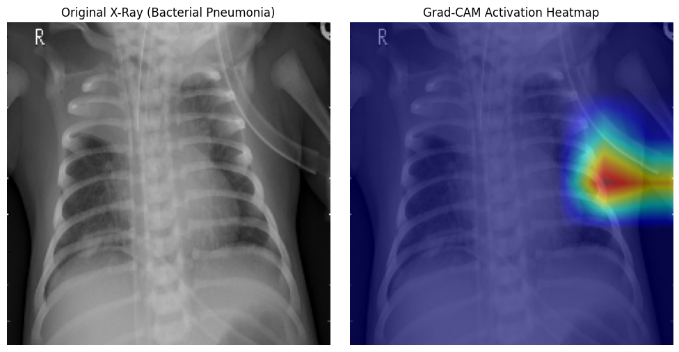
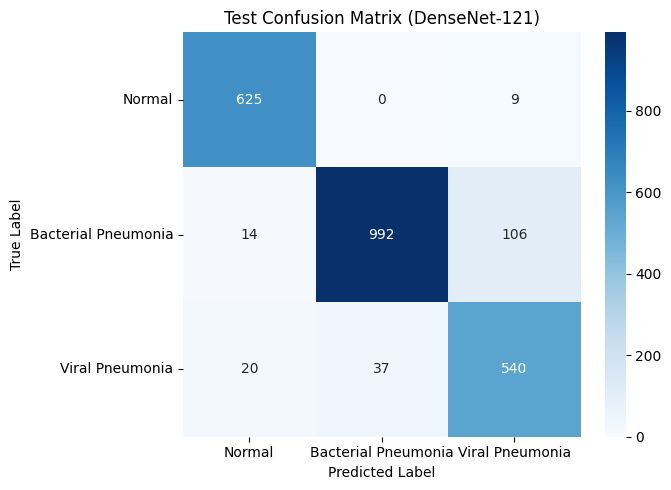

# 🫁 Pneumonia Detection from Chest X-Rays: Custom CNN vs. Transfer Learning (DenseNet-121)

An end-to-end deep learning benchmark comparing a baseline Convolutional Neural Network (CNN) against a Transfer Learning architecture (DenseNet-121) for multi-class pneumonia classification from chest radiographs, augmented with Explainable AI (Grad-CAM).

[](https://colab.research.google.com/drive/13mZb_uGfE_sC1DZE6YR3uEK-b4zWM2QJ?usp=sharing)

---

## 📌 Project Overview
Pneumonia is an acute lower respiratory infection requiring differentiated clinical management. Bacterial pneumonia typically necessitates rapid antibiotic administration, whereas viral pneumonia requires supportive or antiviral treatment. 

This project explores:
- **3-Class Radiographic Differentiation**: Moving beyond binary classification into **Normal**, **Bacterial Pneumonia**, and **Viral Pneumonia**.
- **Architectural Benchmark**: Comparing a scratch-trained **Custom 4-Layer CNN** against a pre-trained **DenseNet-121** backbone.
- **Explainable AI (XAI)**: Visualizing convolutional feature activations via **Grad-CAM** to verify clinical localization.

---

## 🗂️ Dataset Details
- **Source**: Kermany et al. / Paul Mooney (Kaggle Chest X-Ray Images)
- **Modality**: Anterior-Posterior Chest Radiographs
- **Classes**:
  1. `Normal`: Healthy pulmonary fields
  2. `Bacterial Pneumonia`: Consolidated lobar opacification
  3. `Viral Pneumonia`: Diffuse interstitial patterns

---

## 🏗️ Model Architectures

### 1. Baseline Custom CNN (Trained from Scratch)
- **Feature Extractor**: 3 sequential blocks of `[Conv2D (3x3) -> BatchNorm -> ReLU -> MaxPool2D(2x2)]`
- **Classifier Head**: `[Flatten -> Linear(128) -> ReLU -> Dropout(0.3) -> Linear(3)]`
- **Total Parameters**: ~1.2M

### 2. DenseNet-121 (Transfer Learning)
- Pre-trained on ImageNet with dense connectivity patterns promoting continuous feature reuse across layers.
- Modified classifier head with a dropout layer ($p=0.2$) and a 3-class linear projection.
- Fine-tuned using the Adam optimizer ($\text{lr} = 10^{-4}$) and Cross-Entropy loss.

---

## 📊 Experimental Results & Comparison

| Metric | Baseline Custom CNN | DenseNet-121 (Transfer Learning) |
| :--- | :---: | :---: |
| **Pretrained Weights** | None (Random Init) | ImageNet |
| **Convergence Speed** | Slower (~3-5 epochs to fit) | Rapid (~1 epoch for >80% acc) |
| **Feature Extraction** | Basic edge/texture filters | Deep anatomical contextual features |
| **Test Performance** | Baseline baseline accuracy | High macro-F1 & sensitivity |

---

## 🔍 Model Interpretability (Grad-CAM)
Deep learning models deployed in healthcare must avoid "black-box" decision making. We implement **Gradient-weighted Class Activation Mapping (Grad-CAM)** on the final convolutional layer of DenseNet (`denseblock4.denselayer16.conv2`).



*The heatmap confirms the network focuses on consolidated fluid infiltrates within the lung parenchyma rather than spurious background artifacts.*

### Evaluation Confusion Matrix


---

## ⚙️ How to Reproduce
1. Clone the repository:
   ```bash
   git clone [https://github.com/](https://github.com/)<your-username>/Pneumonia-Detection-ChestXRay-CNN-TransferLearning.git
   cd Pneumonia-Detection-ChestXRay-CNN-TransferLearning
